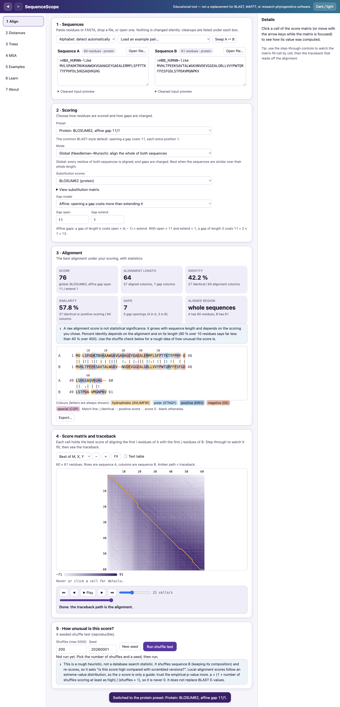
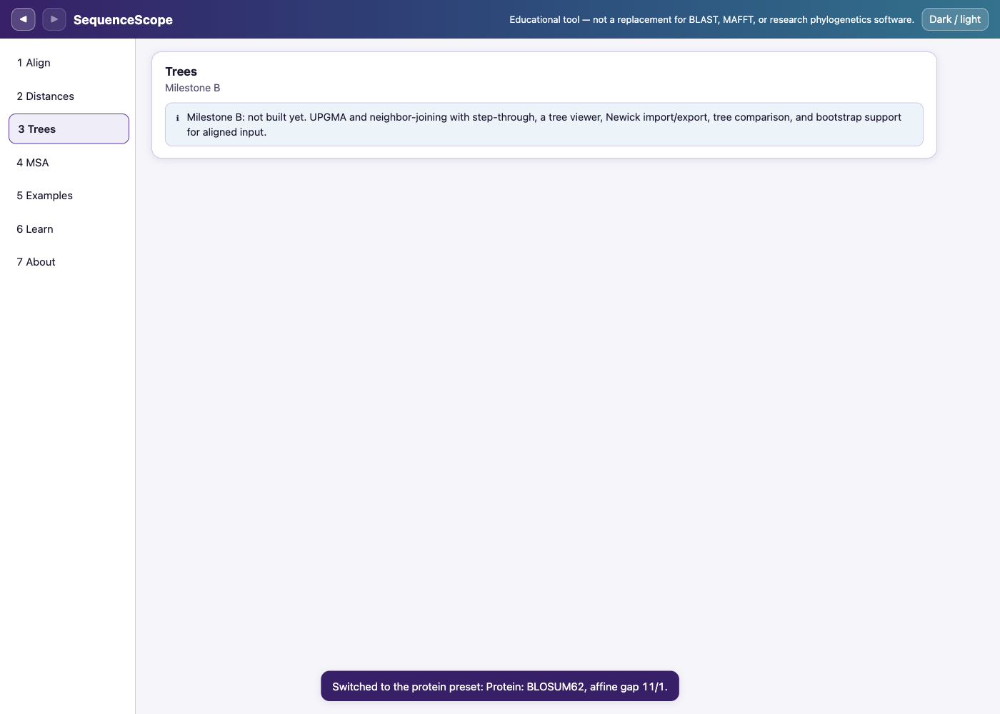
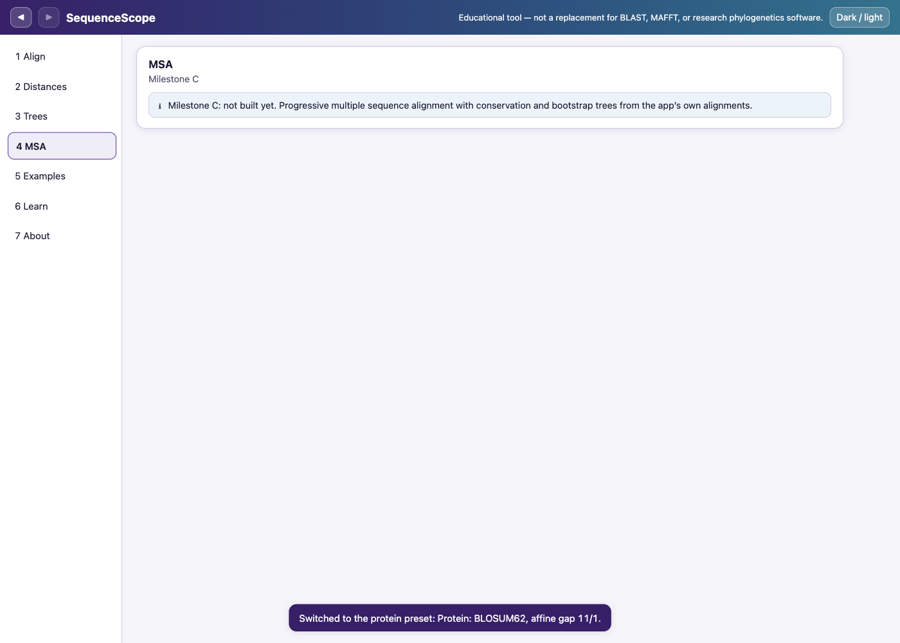
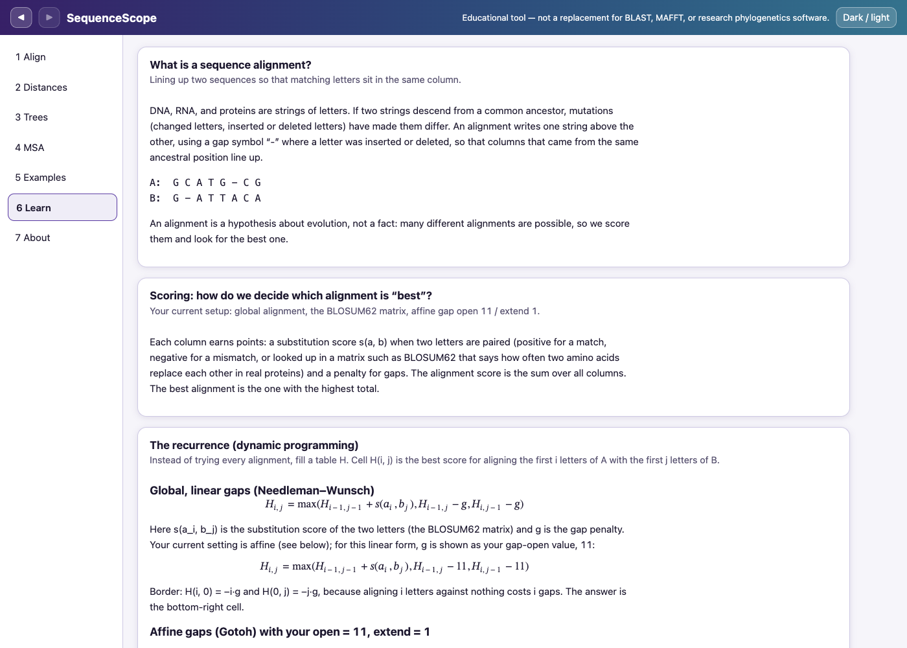

# SequenceScope

**An interactive desktop lab for learning how biological sequences are lined up and how evolutionary trees are built — with every algorithm written from scratch and proved correct by tests.** Align two sequences and watch the score matrix fill and the traceback find the alignment; turn many sequences into a distance heatmap, a UPGMA or neighbor-joining tree, and bootstrap support; align a whole family with a progressive multiple aligner. It is an *educational* tool for Windows, macOS and Linux (Electron + TypeScript) and makes **no network requests**.



| Trees | Multiple alignment | Learn |
|---|---|---|
|  |  |  |

Dark-mode screenshots of every view are in [docs/screenshots](docs/screenshots).

> **Honest scope.** SequenceScope is a teaching tool. It does **not** replace BLAST, MAFFT, Clustal Omega, MUSCLE, or maximum-likelihood/Bayesian phylogenetics programs (IQ-TREE, RAxML, MrBayes). See [Limitations](#limitations).

## Download

Installers are published on the [Releases page](https://github.com/reeper316099/SequenceScope/releases/latest) once the first tag (`v0.1.0`) has been built by GitHub Actions:

| OS | File |
|---|---|
| Windows | `SequenceScope-0.1.0-win-x64-setup.exe` (installer) or `…-portable.exe` |
| macOS | `SequenceScope-0.1.0-mac-universal.dmg` (Apple Silicon and Intel) |
| Linux | `SequenceScope-0.1.0-linux-*.AppImage` or the `.deb` |

`SHA256SUMS.txt` is attached to each release.

### The installers are unsigned — what you will see
There is no code-signing certificate, so your OS warns on first launch. This is expected.
- **Windows SmartScreen** ("Windows protected your PC / unknown publisher"): click **More info → Run anyway**.
- **macOS Gatekeeper** ("cannot be opened because the developer cannot be verified"): drag the app to *Applications*, then **right-click the app → Open → Open**. If needed: `xattr -dr com.apple.quarantine /Applications/SequenceScope.app`.
- **Linux:** `chmod +x SequenceScope-*.AppImage` and run it, or `sudo apt install ./SequenceScope-*.deb`.

Build status: macOS universal and unpacked arm64 builds were built and smoke-tested locally; the **Windows and Linux builds are UNTESTED LOCALLY and verified only by CI** (which had not run yet when this was written). See [docs/RELEASING.md](docs/RELEASING.md) and [docs/MANUAL-CHECKLIST.md](docs/MANUAL-CHECKLIST.md).

## Features

**Pairwise alignment (Align view)** — global (Needleman–Wunsch) and local (Smith–Waterman); linear and affine (Gotoh) gaps; DNA/RNA match–mismatch or BLOSUM45/62/80; step-through of the matrix fill and traceback with the actual numbers; click any cell for its three candidate values; enumeration of co-optimal alignments (capped at 1000); identity (denominator shown), similarity, gap statistics; seeded shuffle test with histogram, z-score and empirical p-value.

**Distances and trees (Distances, Trees views)** — p-distance, Jukes–Cantor, Poisson; gap policy; heatmap and sortable table with saturated cells flagged; UPGMA and neighbor-joining with a step-through of every merge; tree viewer (rectangular phylogram/cladogram, radial) with collapse, rotate, re-root, midpoint/outgroup root, highlight, search, zoom, keyboard navigation and a text outline; Newick import/export/copy, SVG/PNG export; Robinson–Foulds comparison with the disagreeing branches marked; column bootstrap for aligned input.

**Multiple alignment (MSA view)** — progressive alignment with a UPGMA or NJ guide tree; alignment canvas with pinned names, ruler, conservation bars, consensus, colour-blind-safe residue colours (letters always shown); column selection; exports; one-click tree + bootstrap from the app's own alignment.

**Learn view** — the recurrences in MathML with your current numbers, an editable worked example, an interactive saturation plot, a live UPGMA-vs-NJ example, and how progressive alignment works and fails.

**Everything else** — projects (save/open, validated, version-checked), undo/redo, dark mode, native dialogs, all randomness seeded (seed shown and saved), fully offline.

## Validation

The tests are the main story of this project. Numbers below come from real runs on 2026-11-08 (macOS, Apple Silicon, Node 22). Full details: [ALGORITHMS.md](ALGORITHMS.md), [docs/validation/](docs/validation).

**Totals:** 369 unit/property tests in 19 files (all pass), 34 end-to-end Electron tests (all pass; 3 more are gated: packaged-app smoke test, performance, fresh cross-check). Typecheck and lint: 0 errors, 0 explicit `any`. Coverage of `src/bio/`: 97.6 % statements, 89.6 % branches, 99.4 % lines.

**Pairwise alignment**
- *Brute force* (the most important test): for tiny random sequences the DP score equals the best score over **every possible alignment** — global and local, 8 gap settings including affine with open cheaper than extend, DNA and protein, plus an exhaustive sweep of all pairs up to length 3 (3,600 combinations). I mutation-tested it: breaking the affine extension cost makes 7 tests fail, breaking the border initialisation makes 5 fail.
- *Properties* (fast-check, 200 random inputs each): re-scoring with an independent scorer reproduces the score; gap-free rows return the input; swapped sequences give the same score; local ≥ global and ≥ 0; self-alignment equals the diagonal sum (BLOSUM45/62/80 and DNA; only valid when the matrix satisfies s(a,b) ≤ (s(a,a)+s(b,b))/2, which I checked); open = extend equals linear; costlier gaps never help; deterministic output; score-only mode equals the full fill.
- *Biopython 1.86, 44 stored cases* (23 global, 21 local; DNA and protein; linear and affine): **scores equal in 44/44**; our alignments valid; global co-optimal alignment counts equal in 21/21, and unique-optimum strings identical in 9/9; local counts equal in 18/20 (in the other two we enumerate extra tied alignments, each independently re-scoring to the optimum).
- *Textbook/public examples* (4): Rosalind GLOB and GAFF, Wikipedia Needleman–Wunsch and Smith–Waterman — answers reproduced (the Smith–Waterman article states no numeric score; 13 is derived and flagged).
- *Fresh run* (new seed each time, driven through the real UI, comparing the app's exported files): 6 new random alignments matched Biopython with a **maximum score difference of 0**, all alignments valid.

**Distances, UPGMA, neighbor-joining**
- *Exact recovery:* UPGMA rebuilt **200 random ultrametric trees** and NJ **200 random additive trees** (3–14 taxa) plus a 40-taxon tree: same topology, branch lengths within 1e-9.
- *Textbook:* the Wikipedia UPGMA and NJ examples reproduce every merge distance, height, Q value and branch length; replaying the recorded steps rebuilds the final tree exactly.
- *Biopython/SciPy:* NJ equals Biopython's neighbor-joining on all 6 reference matrices (including a negative branch); UPGMA equals SciPy's average linkage on all 6. **Biopython's own `upgma()` is actually WPGMA** (it averages without cluster-size weights): an unweighted reference reproduces it exactly, so I compare UPGMA with SciPy instead. Fresh run: 3 new tie-free sets (6, 8, 10 taxa): NJ Robinson–Foulds distance 0 vs Biopython, UPGMA clades identical to SciPy.
- *Distances:* hand-computed Jukes–Cantor/Poisson values; saturated and undefined pairs never become NaN/Infinity (property-tested); p-distance equals Biopython's identity distance on both MAFFT-aligned example sets except for columns where both sequences have a gap (Biopython counts them as matches; I skip them).
- *Order invariance* on tie-free matrices, *Robinson–Foulds* symmetry and triangle inequality, *Newick* round-trips (property-tested on random trees) and 12 malformed inputs with line/column.

**Bootstrap** — same seed ⇒ identical supports; identical whether replicates are split over 1, 2, 3 or 7 workers in any order; a trivially perfect alignment gives 100 % for every split; conflicting data gives lower support.

**Progressive multiple alignment** — always valid (gap-free rows = inputs, equal lengths, no all-gap column); two sequences reproduce the pairwise alignment exactly; "once a gap, always a gap" verified for every merge; never worse than a trivially padded alignment on 200 seeded sets. Honest numbers: shuffling the input order gave the same sum-of-pairs score in **73 %** of 150 sets (largest difference 18.7 % of the maximum attainable) — no order independence is claimed; against the **exhaustive optimum** of 3 short sequences it reached the optimum in **61 %** of 150 cases (never above); versus **MAFFT 7.526** it agrees on 100 % (globins) and 98.75 % (CYTB) of aligned residue pairs — high because those sets are closely related.

**Tolerances used, and why:** scores are integers and compared exactly; tree branch lengths within 1e-9 (accumulated double-precision rounding is ~1e-16); against Biopython's *Newick text* within 6e-6 (it prints 5 decimals; its stored total lengths agree to 1e-9); float property checks within 1e-12; bootstrap supports are integer counts, compared exactly.

**Performance in the app** (Electron, Apple Silicon; `tests/e2e/perf.spec.ts`; memory = summed working set of all app processes, so it includes the baseline):

| Scenario | Time | Long main-thread tasks (> 50 ms) | Peak memory |
|---|---|---|---|
| Pairwise 5000 × 5000 protein, affine (largest allowed) | 1.07 s | 1 (244 ms) | 920 MB |
| 1000 shuffles of 300 × 300 DNA (local, affine) | 0.86 s | 0 | 945 MB |
| Bootstrap, 100 replicates, 10 × 1144 | 0.14 s | 0 | 666 MB |
| Bootstrap, 100 replicates, 50 × 3000 | 2.35 s | 0 | 603 MB |
| Progressive MSA, 50 × 1000 protein | 17.4 s | 0 | 690 MB |

**End-to-end (hidden windows, no focus stealing):** launch/title/no console errors; numbers match the unit-tested values; keyboard step-through; scoring changes; shuffle seed reproducibility and Cancel; heatmap and saturation; UPGMA/NJ, Newick round-trip, re-root, midpoint root; Robinson–Foulds on a known pair; bootstrap reproducibility; MSA and tree-from-MSA; project save → **restart** → open gives identical results; every bad FASTA and Newick fixture; exports (FASTA, CLUSTAL-style, Newick, PHYLIP, CSV, PNG, SVG); security checks; **no outbound request across a click-through of all seven views**; dark mode persists.

## How to run

Requirements: Node ≥ 22.13, npm. (Python/MAFFT are only needed to regenerate fixtures or example data.)

```bash
npm ci                 # install exact pinned versions
npm run dev            # Electron with hot reload
npm run typecheck      # all four tsconfig projects, zero errors
npm run lint
npm test               # unit + property tests
npm run test:e2e       # builds, then drives the real Electron app (hidden windows)
npm run dist           # builds installers for the current OS into release/
```

Regenerate reference fixtures and example data (optional; results are committed):
```bash
python3 -m pip install --target tools/.pylibs --only-binary=:all: -r tools/requirements.txt   # Biopython 1.86, no virtualenv
npm run ref:generate   # Biopython + SciPy fixtures (SciPy script uses your system SciPy)
npm run examples:fetch # downloads the example sequences by accession (needs a network) and runs MAFFT (brew install mafft)
python3 -I tools/gen_data_sources.py   # rewrites DATA-SOURCES.md and examples/NOTICE from the metadata
```
More: `tools/README.md`. Fresh Biopython/SciPy cross-check, performance and packaged-app tests are described in `tools/crosscheck_fresh.py`, `tests/e2e/perf.spec.ts`, `tests/e2e/packaged.spec.ts`. Releasing: [docs/RELEASING.md](docs/RELEASING.md).

## Security notes
- Renderer: `contextIsolation: true`, `nodeIntegration: false`, `sandbox: true`; no `eval`; no remote code.
- Strict Content-Security-Policy (`default-src 'self'`, `worker-src 'self'`, no network sources, no inline styles/scripts); the app and its examples are served from a custom `app://` protocol that rejects path traversal.
- The preload exposes exactly five functions (`openFile`, `saveFile`, `openExternal`, `getAppInfo`, `copyText`); every argument is validated with zod in the main process; `openFile` enforces a 10 MB cap and a file-type filter; `openExternal` accepts only `https` URLs on a three-host allowlist.
- Navigation away from the app and new windows are blocked; every permission request is denied; any non-local request is cancelled.
- Tested: the e2e suite checks the bridge surface, `require`, traversal, the allowlist, `webPreferences`, and that a full click-through makes no network request. (CI runs Electron with `--no-sandbox` only because GitHub's Ubuntu runners restrict user namespaces; the app's own `sandbox: true` is unchanged.)

## Limitations
- **A raw alignment score is not statistical significance**, and percent identity depends on the alignment and its length. The shuffle test is a heuristic, not a BLAST E-value; the z-score is only a guide because local scores are not normally distributed.
- **UPGMA assumes a constant evolutionary rate** (a molecular clock). Neighbor-joining does not, but both are simple distance methods. Maximum-likelihood and Bayesian programs are what researchers use.
- **A bootstrap value is the percentage of resampled datasets that reproduce a branch.** It measures stability, not the probability that the branch is true.
- **A tree is a hypothesis.** Trees from pairwise-alignment distances are less reliable than trees from a good multiple alignment.
- **Progressive multiple alignment is a heuristic** and is not guaranteed optimal; early mistakes are frozen in.
- **Distance corrections break down at high divergence (saturation)**; such pairs are shown as "saturated"/"undefined".
- Size limits: pairwise ≤ 5,000 × 5,000 residues; ≤ 100 sequences for distances/trees; ≤ 50 sequences × 3,000 residues for MSA (pairwise work cap 1.5 × 10⁹ cell updates); bootstrap ≤ 1000 replicates; scores are whole numbers.
- The BLOSUM matrix files carry no explicit license text (see [DATA-SOURCES.md](DATA-SOURCES.md)).
- Installers are unsigned; Windows/Linux packaging is verified only by CI.

## Data and licenses
Code: MIT ([LICENSE](LICENSE)). Example sequences: UniProt (CC BY 4.0) and NCBI RefSeq (NCBI policy), with attribution in [examples/NOTICE](examples/NOTICE); every record, accession, retrieval date, license sentence, citation and checksum is in [DATA-SOURCES.md](DATA-SOURCES.md) and shown on the app's About and Examples pages.

## Roadmap (stretch features, ranked by impact ÷ effort)
1. **Code signing + notarization + auto-update** — removes the scary OS warnings; high impact, medium effort, needs paid certificates.
2. **Kimura two-parameter distance** (transitions vs transversions) — a small, well-understood addition to `distance.ts`; medium impact, low effort.
3. **Hirschberg linear-space traceback** — aligning very long sequences without the 25 M-cell cap; medium impact, medium effort.
4. **Maximum-likelihood score for a fixed topology** (Jukes–Cantor) — lets users compare trees by likelihood and is a stepping stone toward real phylogenetics; high educational impact, medium–high effort.
5. **Live fetching from NCBI/UniProt** through an allowlisted main-process fetch — convenient, but it adds the app's first network use and privacy considerations; medium impact, medium effort.

## What I learned
<!-- TODO(you): write this section in your own words — what surprised you, what was hard (for example Biopython's "UPGMA" being WPGMA, or affine-gap conventions), and what you would do next. This is deliberately left for you. -->

*(To be written by the author.)*
