# Architecture

SequenceScope is a teaching lab for pairwise alignment, distances / trees / bootstrap, and progressive multiple sequence
alignment (MSA). It is a **Tauri 2 desktop app**: a TypeScript page (the UI) talking to a **Rust core** (all the science).
All calculation is local; the app makes no network requests of its own.

This page is the map. For the *why* behind individual algorithms see [ALGORITHMS.md](../ALGORITHMS.md); for what is allowed
to cross the boundary see [src-tauri/PERMISSIONS.md](../src-tauri/PERMISSIONS.md); for how the Rust port was proven equal to
the original TypeScript see [docs/rust-migration/](rust-migration/).

## The big picture

```
┌───────────────────────── Tauri window (system WebView) ─────────────────────────┐
│  src/ (TypeScript, no framework)                                                │
│                                                                                 │
│   ui/*  views, canvases, steppers      io/*  export, project save/load          │
│        │                                                                        │
│        ▼                                                                        │
│   backend/api.ts   ── typed calls: align, shuffle, distances, bootstrap, msa ─┐ │
│        │                                                                      │ │
│   backend/rust.ts (RustWorker)   backend/ops.ts   backend/frame.ts            │ │
│        │  invoke(command, args) + Channel<progress>                           │ │
└────────┼──────────────────────────────────────────────────────────────────────┼─┘
         ▼                                                                      │
┌─────────────────────────────── src-tauri (Rust shell) ────────────────────────┴─┐
│ commands.rs  one #[tauri::command] per capability (validate → spawn → stream)    │
│ validate.rs / allowlist.rs / fileio.rs   input checks, https allowlist, 10 MB cap│
│ jobs.rs      job ids, cancellation        menu.rs   native File/Edit/View/Help   │
│ compute.rs, ops*.rs, results.rs, dto.rs   glue between commands and the core     │
└───────────────────────────────────────┬──────────────────────────────────────────┘
                                        ▼
┌─────────────────── crates/sequencescope-core (pure Rust, no Tauri) ──────────────┐
│ pairwise, scoring, matrices, alphabet, fasta, shuffle, rng, alignstats            │
│ distance, upgma, nj, tree, newick, bootstrap, treecompare                         │
│ msa, conservation, verify                                                         │
└───────────────────────────────────────────────────────────────────────────────────┘
```

Three layers, each only knowing the one below it:

| Layer | Where | Knows about |
|---|---|---|
| UI | `src/ui`, `src/io`, `src/main.ts` | Result types and `backend/api.ts`. Never the algorithms. |
| Shell | `src-tauri/src` | Tauri, validation, jobs, menu. Calls the core. |
| Core | `crates/sequencescope-core` | Nothing but the standard library and its own data. Testable with plain `cargo test`. |

## The core crate

`crates/sequencescope-core` is a plain library with **no Tauri dependency**, which is what makes it fast to test and
reusable. Module groups:

* **Alignment:** `pairwise` (Needleman–Wunsch, Smith–Waterman, linear and affine gaps), `scoring`, `matrices` (BLOSUM / PAM
  data embedded in the binary, hash-checked in tests), `alphabet`, `alignstats`.
* **Significance:** `shuffle` (null distribution) and `rng` (a seeded generator that reproduces the original JavaScript
  sequence exactly).
* **Distances and trees:** `distance` (p, Jukes–Cantor, Kimura…), `upgma`, `nj`, `tree`, `newick`, `bootstrap`, `treecompare`
  (Robinson–Foulds).
* **MSA:** `msa` (progressive alignment along a guide tree, plus an exhaustive-optimum search used by the Learn view),
  `conservation`, `verify`.
* **Input:** `fasta`, `error`; `jsnum` reproduces JavaScript number formatting and arithmetic quirks where the output had to
  match the original byte for byte.

Rule of thumb: if it computes something a student might question, it is in the core and has a test.

## The Tauri shell

`src-tauri` is deliberately thin. A command does the same four things every time: **validate** the input, **spawn** the work
on a background thread, **stream** progress back over a `Channel<T>`, and **return** the result. Heavy results (an alignment
matrix of tens of megabytes) are returned as raw bytes, not JSON.

* `commands.rs` registers the commands. The `bio_op` command is one tagged enum for the many small tree / MSA operations, so
  the permission surface stays small.
* `jobs.rs` gives every long job an id so the UI can cancel it; the work checks a flag as it runs.
* `validate.rs`, `allowlist.rs`, `fileio.rs` are the security edge: input limits, the only URLs `open_external` will open
  (https hosts on a fixed list), and the file-size cap and safe-name rules for open/save.
* `menu.rs` builds the native menu. A menu click never runs anything itself: it dispatches one command from a **fixed list**
  to the page as a `menu-action` event. A unit test checks the list equals `MENU_ACTIONS` in `src/shared/types.ts`.
* `smoke.rs` runs checks *inside the real built window* (26 of them: CSP, menu, permissions, no workers…).

## The UI

TypeScript, no UI framework, drawing mostly to `<canvas>`.

* `ui/*` – one file per view (`alignView`, `distancesView`, `treesView`, `msaView`, `examplesView`, `learnView`,
  `aboutView`) plus the shared parts: canvases (`matrixCanvas`, `msaCanvas`, `distanceHeatmap`), steppers that replay an
  algorithm step by step, `model.ts` / `dataStore.ts` (state), `history.ts` (undo/redo), `theme.ts`, `storage.ts`.
* `io/*` – export (PNG / SVG / Newick / FASTA…) and project save/load, validated by `shared/schemas.ts`.
* `shared/` – `types.ts` (the menu command list, view names), `results.ts` (the **types** of every result; types only),
  `schemas.ts`.
* `bio/` – only `errors.ts` (`BioError`) and `treeAccess.ts` (read-only tree helpers for drawing). There are no algorithms
  in TypeScript any more.
* `backend/` – the seam to Rust:
  * `api.ts` – the typed functions the views call.
  * `rust.ts` – `RustWorker`, which keeps the old "worker-like" shape (post a request, get progress, a result, or a cancel)
    so the views did not need to change.
  * `ops.ts`, `frame.ts` – request encoding and decoding of the streamed result frames.
* `tauri/` – the bridge to Tauri (`bridge.ts`), the in-window `smoke.ts` and `bench.ts`.

## Security model

The page is treated as untrusted-ish and the shell as the gatekeeper:

* **Capabilities:** one capability file, main window only. It lists exactly one `allow-<command>` per declared command and
  nothing else. No `core:*` defaults, no fs / shell / http / process plugins.
  `src-tauri/src/lockdown_tests.rs` fails if that changes.
* **Content-Security-Policy:** strict, with `worker-src 'none'` (the page runs no Web Workers) and no outside network
  (`connect-src` limited to Tauri's IPC).
* **Files:** the page never gets a path to read. Open and save go through native dialogs in Rust, with a 10 MB cap and a
  whitelist of kinds and file names.
* **Links:** `open_external` accepts only https URLs on the allowlist; Help menu links use the same check.

## Testing

| Suite | Command | What it proves |
|---|---|---|
| Rust unit + property | `cargo test --workspace` | Algorithms, validation, menu, lockdown, ported textbook cases |
| Parity fixtures | part of `cargo test` | Rust equals the frozen TypeScript reference outputs (`tests/fixtures/parity/`, tag `ts-reference-v0.1.0`) |
| TypeScript unit | `npm test` | UI helpers, IO, frame decoder, `RustWorker` |
| Bridge UI tests | `npm run test:bridge` | The real production page, driven by Playwright + Chrome, against the real Rust functions |
| In-window smoke | built app, `smoke` mode | The built executable: CSP, menu, permissions, 26 checks |
| Lint / format | `cargo fmt`, `cargo clippy -D warnings`, `npm run lint`, typecheck | Style and static checks |

### The test bridge

A browser cannot call Tauri commands, so `src-tauri/src/bin/test_bridge.rs` (feature `test-bridge`, **never shipped**) serves
the built page and answers `POST /invoke/<command>` by calling the same plain Rust functions the commands call. A ~60 line
shim (`tests/bridge/shim.ts`) replaces `window.__TAURI_INTERNALS__` in the page. The bridge listens on loopback only,
checks the `Host` header, serves files only below its folder, and has no file, dialog or shell commands. Native-only
commands (open/save dialog, open link, app info, copy) are test doubles in `tests/bridge/helpers.ts`.

What this does **not** cover: WebView-specific rendering (WebKit on macOS/Linux, WebView2 on Windows). Only the smoke test
and the manual checklist ([MANUAL-CHECKLIST.md](MANUAL-CHECKLIST.md)) look at the real window.

## Build, CI, release

* **Dev:** `npx tauri dev`. **Build:** `npx tauri build`.
* **CI** (`.github/workflows/ci.yml`, Ubuntu / Windows / macOS): fmt, clippy (with and without `test-bridge`), `cargo test`,
  `npm test`, `npm run test:bridge`, a debug Tauri build plus the in-window smoke test. Versions in `package.json`,
  `tauri.conf.json` and `Cargo.toml` must agree.
* **Release** (`release.yml`, on a version tag): `tauri build` per OS (macOS as `universal-apple-darwin`), uploads the
  `.dmg`, `.msi`, `-setup.exe`, `.AppImage`, `.deb`, and a `SHA256SUMS` job. See [RELEASING.md](RELEASING.md).
* `.gitattributes` marks `data/`, `examples/` and `tests/fixtures/` as `-text` so Windows checkouts do not rewrite line
  endings (it changed a data-file hash once).

## Repository map

```
crates/sequencescope-core/   the science (pure Rust) + its tests
src-tauri/                   Tauri shell: commands, validation, menu, smoke, test bridge, capabilities, icons
src/                         the TypeScript UI
tests/bridge/                Playwright specs run against the test bridge
tests/unit/                  TypeScript unit tests
tests/fixtures/              frozen reference data (parity JSON, Biopython / SciPy references, FASTA / Newick cases)
tools/                       reference generators (Python), benchmarks, bridge runner
data/, examples/             substitution matrices and teaching examples
docs/                        this page, releasing, manual checklist, validation, migration notes
```

## Decisions worth knowing

* **Rust core, TypeScript UI.** The migration from an all-TypeScript Electron app changed the engine and the shell, not the
  behaviour. Equality is proven by frozen reference outputs, not asserted.
* **No framework in the UI.** The app is a teaching tool; the views are short, direct DOM and canvas code that is easy to read.
* **One tagged `bio_op` command** instead of dozens, to keep the permission list short and checkable.
* **`RustWorker` kept** as the page's job interface, because the views were written against that shape and rewriting it
  would be a refactor with no user benefit.
* **The TypeScript engine is gone** but recoverable: tag `ts-reference-v0.1.0`. To regenerate the parity fixtures, check
  that tag out in a worktree (see `tests/fixtures/parity/README.md`).


## Diagram

```mermaid
%% Generated by https://gitdiagram.com/reeper316099/sequencescope
flowchart TD

subgraph group_interface["User interface"]
  node_app["App orchestration<br/>[main.ts]"]
  node_pairview["Align view<br/>[alignView.ts]"]
  node_distanceview["Distances view<br/>[distancesView.ts]"]
  node_treesview["Trees view<br/>[treesView.ts]"]
  node_msaview["MSA view<br/>[msaView.ts]"]
  node_treevisual["Tree viewer<br/>[treeView.ts]"]
  node_learnview["Learn view<br/>[learnView.ts]"]
end

subgraph group_workflow["Sequence workflows"]
  node_compare["Tree comparison<br/>[compareView.ts]"]
end

subgraph group_engine["Rust algorithms"]
  node_pairwise["Pairwise alignment<br/>[pairwise.rs]"]
  node_distances["Distance models<br/>[distance.rs]"]
  node_trees["Tree inference<br/>[upgma.rs]"]
  node_nj["Neighbor joining<br/>[nj.rs]"]
  node_bootstrap["Column bootstrap<br/>[bootstrap.rs]"]
  node_msa["Progressive alignment<br/>[msa.rs]"]
  node_newick["Newick and trees<br/>[newick.rs]"]
  node_treecompare["Tree comparison core<br/>[treecompare.rs]"]
end

subgraph group_bridge["Desktop bridge"]
  node_api["Bio API<br/>[api.ts]"]
  node_workers["Job workers<br/>[index.ts]"]
  node_rustworker["Rust worker adapter<br/>[rust.ts]"]
  node_tauri["Tauri commands<br/>[lib.rs]"]
  node_compute["Job compute<br/>[compute.rs]"]
end

subgraph group_state["Files and state"]
  node_projects["Project files<br/>[project.ts]"]
  node_results["Shared result types<br/>[results.ts]"]
end

node_user(("Researcher"))

node_user -->|"uses"| node_app
node_app -->|"creates"| node_pairview
node_app -->|"creates"| node_distanceview
node_app -->|"creates"| node_treesview
node_app -->|"creates"| node_msaview
node_app -->|"saves and loads"| node_projects
node_msaview -->|"sends alignment"| node_distanceview
node_treesview -->|"renders trees"| node_treevisual
node_treesview -->|"offers comparison"| node_compare
node_compare -->|"renders comparison"| node_treevisual
node_compare -->|"compares trees"| node_api
node_user -->|"explores concepts"| node_learnview
node_pairview -.->|"requests alignment"| node_api
node_distanceview -.->|"requests distances"| node_api
node_treesview -->|"requests trees"| node_api
node_api -->|"creates jobs"| node_workers
node_workers -->|"instantiates"| node_rustworker
node_rustworker -.->|"invokes commands"| node_tauri
node_tauri -->|"registers compute"| node_compute
node_compute -.->|"runs alignment"| node_pairwise
node_compute -.->|"computes distances"| node_distances
node_compute -.->|"builds trees"| node_trees
node_compute -.->|"builds trees"| node_nj
node_compute -.->|"runs bootstrap"| node_bootstrap
node_compute -.->|"runs alignment"| node_msa
node_compute -.->|"tree operations"| node_newick
node_compute -.->|"tree operations"| node_treecompare
node_api -->|"uses contracts"| node_results

click node_app "https://github.com/reeper316099/sequencescope/blob/main/src/main.ts"
click node_pairview "https://github.com/reeper316099/sequencescope/blob/main/src/ui/alignView.ts"
click node_distanceview "https://github.com/reeper316099/sequencescope/blob/main/src/ui/distancesView.ts"
click node_treesview "https://github.com/reeper316099/sequencescope/blob/main/src/ui/treesView.ts"
click node_msaview "https://github.com/reeper316099/sequencescope/blob/main/src/ui/msaView.ts"
click node_treevisual "https://github.com/reeper316099/sequencescope/blob/main/src/ui/treeView.ts"
click node_learnview "https://github.com/reeper316099/sequencescope/blob/main/src/ui/learnView.ts"
click node_compare "https://github.com/reeper316099/sequencescope/blob/main/src/ui/compareView.ts"
click node_api "https://github.com/reeper316099/sequencescope/blob/main/src/backend/api.ts"
click node_workers "https://github.com/reeper316099/sequencescope/blob/main/src/backend/index.ts"
click node_rustworker "https://github.com/reeper316099/sequencescope/blob/main/src/backend/rust.ts"
click node_tauri "https://github.com/reeper316099/sequencescope/blob/main/src-tauri/src/lib.rs"
click node_compute "https://github.com/reeper316099/sequencescope/blob/main/src-tauri/src/compute.rs"
click node_pairwise "https://github.com/reeper316099/sequencescope/blob/main/crates/sequencescope-core/src/pairwise.rs"
click node_distances "https://github.com/reeper316099/sequencescope/blob/main/crates/sequencescope-core/src/distance.rs"
click node_trees "https://github.com/reeper316099/sequencescope/blob/main/crates/sequencescope-core/src/upgma.rs"
click node_nj "https://github.com/reeper316099/sequencescope/blob/main/crates/sequencescope-core/src/nj.rs"
click node_bootstrap "https://github.com/reeper316099/sequencescope/blob/main/crates/sequencescope-core/src/bootstrap.rs"
click node_msa "https://github.com/reeper316099/sequencescope/blob/main/crates/sequencescope-core/src/msa.rs"
click node_newick "https://github.com/reeper316099/sequencescope/blob/main/crates/sequencescope-core/src/newick.rs"
click node_treecompare "https://github.com/reeper316099/sequencescope/blob/main/crates/sequencescope-core/src/treecompare.rs"
click node_projects "https://github.com/reeper316099/sequencescope/blob/main/src/io/project.ts"
click node_results "https://github.com/reeper316099/sequencescope/blob/main/src/shared/results.ts"

classDef toneNeutral fill:#f8fafc,stroke:#334155,stroke-width:1.5px,color:#0f172a
classDef toneBlue fill:#dbeafe,stroke:#2563eb,stroke-width:1.5px,color:#172554
classDef toneAmber fill:#fef3c7,stroke:#d97706,stroke-width:1.5px,color:#78350f
classDef toneMint fill:#dcfce7,stroke:#16a34a,stroke-width:1.5px,color:#14532d
classDef toneRose fill:#ffe4e6,stroke:#e11d48,stroke-width:1.5px,color:#881337
classDef toneIndigo fill:#e0e7ff,stroke:#4f46e5,stroke-width:1.5px,color:#312e81
classDef toneTeal fill:#ccfbf1,stroke:#0f766e,stroke-width:1.5px,color:#134e4a
class node_app,node_pairview,node_distanceview,node_treesview,node_msaview,node_treevisual,node_learnview toneBlue
class node_compare toneAmber
class node_pairwise,node_distances,node_trees,node_nj,node_bootstrap,node_msa,node_newick,node_treecompare toneMint
class node_api,node_workers,node_rustworker,node_tauri,node_compute toneRose
class node_projects,node_results,node_user toneIndigo
```


